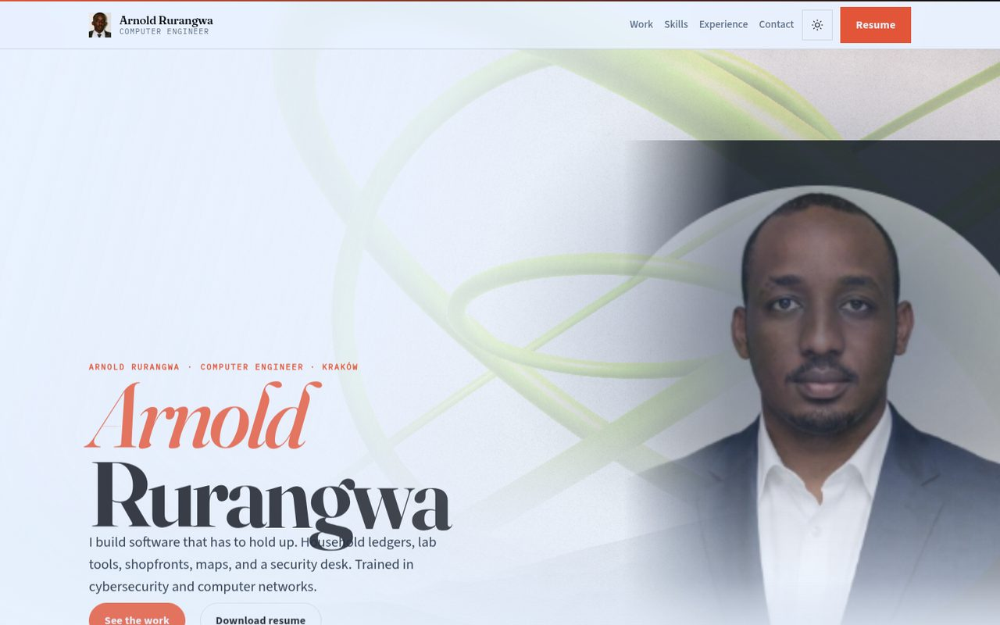

# Arnold Rurangwa — Portfolio

Personal engineering folio and resume for Arnold Rurangwa, computer engineer in Kraków. Software, Linux, IT support, and cybersecurity / SOC.

[](https://arnold-rg.github.io/arnold-portfolio/)

**Live:** [https://arnold-rg.github.io/arnold-portfolio/](https://arnold-rg.github.io/arnold-portfolio/)

[](https://arnold-rg.github.io/arnold-portfolio/)

## Features

- Editorial portfolio: selected work, skills, experience, and contact
- Project ring with a live link and source link for each public project
- Downloadable resume (PDF)
- Works on phones and desktop browsers, no account required

## Tech stack

| Layer | Tools |
| --- | --- |
| Markup & style | HTML5, CSS3, vanilla JavaScript |
| Hosting | GitHub Pages, from the `main` branch root |
| License | MIT — see [LICENSE](LICENSE) |

## Getting started

```bash
git clone https://github.com/Arnold-RG/arnold-portfolio.git
cd arnold-portfolio
python3 -m http.server 8000
```

Open [http://127.0.0.1:8000/](http://127.0.0.1:8000/).

## Project structure

```text
index.html     The site
assets/        Styles, scripts, portrait, logo, resume
docs/          README screenshot
Folio/         Earlier version, kept for reference
SECURITY.md    Vulnerability disclosure
```

## Publish

GitHub Pages builds from `main`. The workflow in `.github/workflows/pages.yml` can also publish through GitHub Actions.

## Tests

This is a static site with no automated test suite.

## License

MIT. See [LICENSE](LICENSE).

## Author

Arnold Rurangwa

- [GitHub](https://github.com/Arnold-RG)
- [LinkedIn](https://www.linkedin.com/in/rurangwa-arnold-53b90520b/)
- [rurangwaarnold32@gmail.com](mailto:rurangwaarnold32@gmail.com)
- Kraków, Poland
